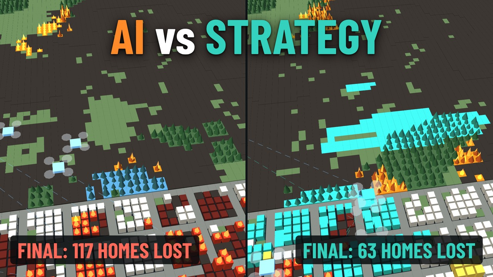

# Firebreak: AI strategies for a drone fleet against wildfires



▶️ **Video:** [I Tested 4 AI Strategies Against a Wildfire. Strategy Beat Smarter AI.](https://youtube.com/) *(link coming)*

A small fleet of firefighting drones faces more spot fires than it can reach, while the wind pushes
the fire toward a town. Which way of planning the flights saves the most homes: a greedy rule, a
genetic algorithm, particle swarm optimization, or a graph neural network trained with reinforcement
learning?

**Short answer:** the biggest improvement wasn't a smarter AI. It came from giving the drones a better
action, the **firebreak**. With firebreaks, all four strategies tie, and the simplest one is about
40× faster than the search methods.

> This is a simulation study, not a field-tested firefighting system.

---

## Key results

6 drones, 18 spot fires, wind 8 m/s, a town of 316 homes. Mean homes lost over the same 50 maps for
every method (lower is better). "Clearly better/worse" means the 95% interval of the paired
difference excludes zero.

| Strategy | Water only | Water + firebreaks | Decision time |
| --- | --- | --- | --- |
| No drones | 176.6 | – | – |
| Greedy (value at risk) | 111.5 | **76.1** | 0.15 ms |
| Genetic algorithm | 108.0 | 79.1 | ~8 ms |
| Particle swarm | 109.8 | 78.4 | ~8 ms |
| Graph neural network (RL) | – | **76.1** (identical to greedy on all 50 maps) | ~3–5 ms |
| Nearest fire first | 154.3 | 155.9 | 0.1 ms |

- **Firebreaks cut losses from about 110 to about 77 homes.** A firebreak costs one load of water,
  the same as a normal drop.
- **The four planners tie.** The neural network learned one habit, "if there's room ahead of a fire,
  lay a firebreak", which is exactly what the greedy rule does.
- **Placement matters.** Firebreaks laid at the nearest fire, instead of the most dangerous one, lose 156 homes.

### Stress test (28 conditions × 30 maps)

One change at a time: fleet size, number of fires, wind speed, sensor noise, missed fires, drone
failures, sensing range and a sudden wind shift. `greedy_break` was **never clearly beaten**. Its
weakest condition is short sensing range (600 m: 70 → 118 homes lost), so a real fleet would need a
shared picture of the fire.

### Second fire model: MITRE SimFire (50 maps)

Same drones, maps and scoring, but fire spread from [MITRE SimFire](https://github.com/mitrefireline/simfire)
(Rothermel rate of spread, Anderson fuel models, terrain with slope).

| Strategy | Homes lost | vs greedy_break |
| --- | --- | --- |
| greedy_break | 75.2 | reference |
| Graph neural network | 75.2 | identical on all 50 maps |
| Genetic algorithm + firebreaks | 74.0 | −1.2, tie |
| Particle swarm + firebreaks | 71.1 | −4.1, tie |
| Water only (greedy) | 127.9 | +52.7, clearly worse |
| Nearest fire + firebreaks | 165.2 | +90.1, clearly worse |
| No drones | 212.0 | +136.8, clearly worse |

Same conclusion under different physics: firebreaks save about 53 homes (95% CI 43.5 to 61.9), and
the planners tie.

### Recommendation

`greedy_break` (greedy on expected value saved + the firebreak rule) is the controller to rely on. It
was never clearly beaten in either fire model or any stress condition, it is deterministic and
explainable, and it decides in about 0.2 ms. Its objective is monotone submodular, so greedy is within
(1 − 1/e) of the best assignment at every decision. In any real use, a human incident commander stays
in charge.

---

## How it works

**World** (`firebreak/world.py`): 96 × 96 grid of 40 m cells (3.84 km). Grass, forest, a lake, a town
with homes and critical sites. Fire spreads to neighbours with a wind-dependent probability; burning
forest and buildings throw embers downwind. Drones fly with limited speed and acceleration, carry 4
loads of water, refill at the lake or base, and recharge their batteries.

**Objective:** each fire sector *j* threatens value *v_j*; drone *i* puts it out with probability
*p_ij*. A plan is scored by expected value saved, J = Σ_j v_j [1 − Π_i (1 − p_ij)].

**Strategies:**

| Strategy | Idea |
| --- | --- |
| Greedy | Assign drones one at a time to the sector with the largest gain in J |
| Genetic algorithm | Population of 48 plans, 30 generations, tournament selection, uniform crossover, elitism |
| Particle swarm | 32 particles over random-key encodings, 40 iterations |
| Graph neural network | Message passing between drones within 1.5 km; behaviour cloning + DAgger from greedy_break, then MAPPO-style PPO |
| `_break` variants | Same planner + the firebreak rule: lay a wet strip across the wind, downwind of the fire |

---

## Install

```bash
python -m venv .venv && source .venv/bin/activate
pip install -r requirements.txt          # numpy, torch, matplotlib
python tests/test_smoke.py               # ~30 s: checks sim, controllers, env, policy
```

## Reproduce the results

```bash
cd scripts
# main comparison (50 maps)
python evaluate.py --seeds 50 --wind 8 --policy ../runs/gnn4/best.pt \
    --controllers greedy_break gnn_policy ga_break pso_break nearest_break greedy_c_stable ga_stable pso_stable nearest none
# stress test (28 conditions x 30 maps)
python stress_test.py --seeds 30 --out ../results/stress
python stress_test.py --seeds 30 --controllers greedy_break gnn_policy greedy_c_stable \
    --policy ../runs/gnn4/best.pt --out ../results/stress30_gnn
# wind sweep
python wind_sweep.py --winds 0 2 4 6 8 10 12 14 --seeds 20 --out ../results/wind
# record a replay for the 3D viewer
python record.py --controllers greedy_c_stable greedy_break --seed 3005 --wind 8 --out ../replays/showcase.json
```

Train the GNN yourself (a few hours on a 16-core CPU):

```bash
python train_ppo.py --mode break --bc-episodes 20 --dagger-rounds 2 --iters 200 \
    --wind-min 2 --wind-max 12 --out ../runs/gnn4
```

In `--mode break` (default), greedy picks each drone's sector and the GNN decides attack / firebreak
/ hold; `--mode full` lets the GNN pick the sector too (harder to learn: it ended 35 homes behind the
rule). Training writes `bc.pt`, `log.csv`, `last.pt` and `best.pt` (best held-out score). The trained
weights used in the results are in `runs/gnn4/best.pt`.

### SimFire (second fire model)

`--world simfire` keeps everything the controllers see and do and swaps only the fire spread for
SimFire's physics: Rothermel rate of spread, Anderson fuel models (grass FM1, timber FM10, town lots
FM2), Perlin terrain with slope, midflame wind (40% of the 10 m wind), 4-minute burn duration.
Firebreaks act like SimFire wetlines; our ember spotting stays on (SimFire has none). Episodes run
3600 s because Rothermel fires are slower. Code: `firebreak/simfire_world.py`.

SimFire needs Python 3.9, so it gets its own environment:

```bash
curl -LsSf https://astral.sh/uv/install.sh | sh        # installs uv; open a new terminal after
uv venv -p 3.9 ~/sf39 && source ~/sf39/bin/activate
uv pip install simfire "setuptools<70" matplotlib
uv pip install torch --index-url https://download.pytorch.org/whl/cpu
cd scripts
python evaluate.py --world simfire --wind 8 --seeds 50 --policy ../runs/gnn4/best.pt \
    --controllers greedy_break gnn_policy ga_break pso_break nearest_break greedy_c_stable none
```

Warnings about pydantic, fonts or `XDG_RUNTIME_DIR` come from SimFire's imports and are harmless.

## Repository layout

| Path | What it is |
| --- | --- |
| `firebreak/world.py` | The simulation: map, fire spread, wind, embers, drones, scoring, stress settings |
| `firebreak/controllers.py` | Objective, nearest, greedy, GA, PSO (+ `_stable` and `_break` variants) |
| `firebreak/simfire_world.py` | Same world with MITRE SimFire's Rothermel fire physics |
| `firebreak/env.py` | Multi-agent RL environment, observation builder, `PolicyController` adapter |
| `firebreak/policy.py` | GNN actor (message passing over the drone comm graph) + centralised critic |
| `scripts/` | `train_ppo.py`, `evaluate.py`, `stress_test.py`, `wind_sweep.py`, `record.py` |
| `runs/gnn4/` | Trained GNN weights and training log |
| `results/` | Evaluation outputs (CSV, summaries, plots) |
| `viewer/viewer.html` | 3D replay viewer: open it in a browser and load a replay JSON |
| `viewer/results.html` | Visual results page |

## Write your own controller

```python
def my_controller(world, avail, targets, P, rng):
    # avail: drones that can act; targets: fire sectors (bin, n, value, aim arrays)
    # P[i, j]: chance drone i puts out sector j. Return one sector index per drone, -1 = hold.
    return P.argmax(1)
```

Add it to `CONTROLLERS` in `controllers.py` and every script can run it by name. Can you beat
`greedy_break`?

## Limitations

- A simplified, game-level simulation, not validated against real fire incidents.
- The SimFire check changes the fire physics only; drones, sensing and the town model are the same.
- The GNN was trained with 6 drones; results for other fleet sizes are extrapolation.
- Real deployment would need shared situational awareness, airspace rules, communications and a
  human in command.

## Acknowledgements

- [MITRE SimFire](https://github.com/mitrefireline/simfire) for the Rothermel fire-spread implementation and fuel models.
- 3D viewer built with [three.js](https://threejs.org/).

## License

MIT, see [LICENSE](LICENSE).
